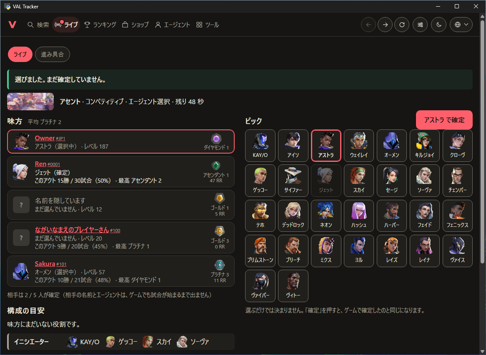
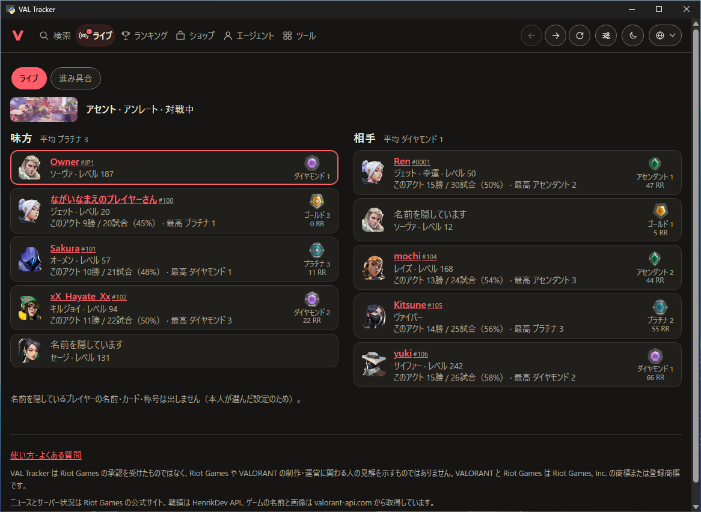
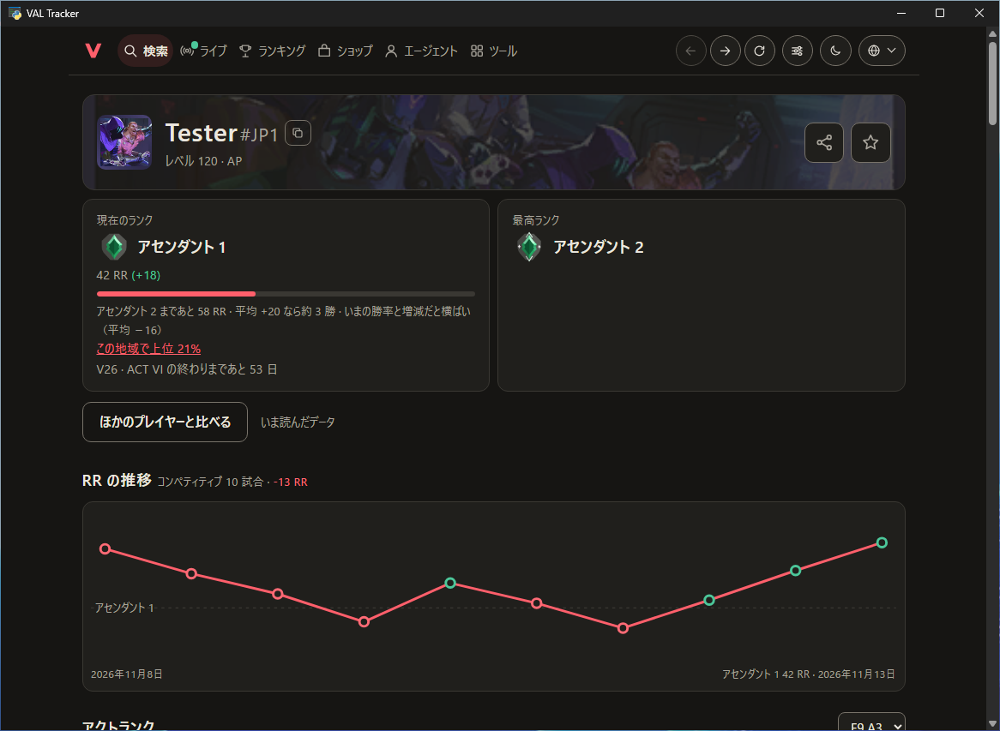
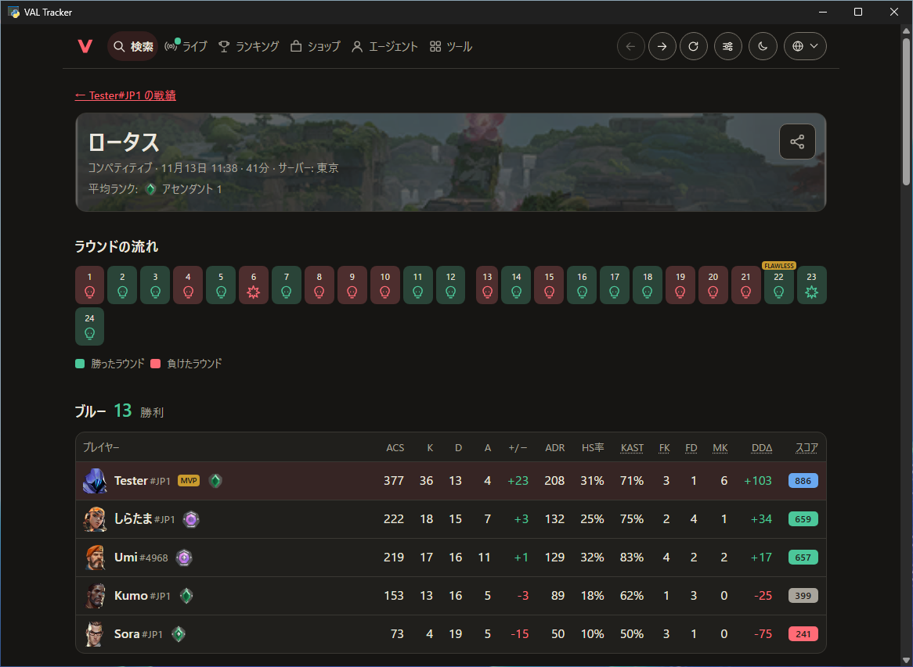

# VAL Tracker

VALORANT のトラッカー。Riot ID でプレイヤーのランクと最近の試合（KAST・ラウンドの流れなど）を調べ、お気に入りに登録できる。
地域のランキング、ストアのバンドル、スキン図鑑（動画・評価）、ニュース、eスポーツ、エージェントの能力と使用率・勝率、
プレイヤー同士の比較、クロスヘアのコード表示と保存、サーバー状況、サーバーごとの混む時間帯と待ち時間の目安、
いま出るマップとパーティーのランク差、感度の換算も見られる。持ち主は Riot と連携して今日のストアと履歴、所持品と装備、
バトルパス・契約・ミッション、いまの試合（起動の検知、キューの開始、ピックと確定、全員のランク）も使える。
4 言語（日本語・韓国語・英語・繁体字中国語）、ダーク / ライト、スマホ対応。サイト一覧（Home Page）に Python のサイトとして `/val` に載る。

設計・ほかのトラッカーとの比べ・今後は [docs/DESIGN.md](docs/DESIGN.md)。

## 動かす

```bash
python -m pip install -r requirements.txt
python -m valtracker            # http://127.0.0.1:5050/ （この PC だけ。設定も開ける）
python -m unittest discover -s tests
```

- 戦績には HenrikDev API のキーが要る。[ダッシュボード](https://api.henrikdev.xyz/dashboard/)の「API Keys」で作り、画面の「設定」に入れる（`instance/settings.json` に保存。Git には入らない）。試すだけなら環境変数 `VAL_HENRIK_KEY` でもよい
- 所持品（`/val/collection`、持ち主だけ）は、設定に Riot の `ssid` クッキーを一度貼ると見られる（手順は設定ページ。仕組みは [DESIGN.md](docs/DESIGN.md#riot-のログイン段階2valtrackerriotpy)）
- エージェントやマップの名前と絵は valorant-api.com から取り、`instance/` にためて自分のアドレスで出す（外部の読み込みはしない）

## PC アプリ（Windows）

サイトと同じ画面を、VALORANT と同じ PC で専用のウィンドウに開く。Riot クライアントにサインインしていれば ssid を貼らずに
持ち主の機能（ライブ・ショップ・所持品・進み具合）が使え、ライブは Riot クライアントの知らせで、試合が見つかった瞬間・
ピックのたびにすぐ切り替わる。

| エージェント選択                                                       | 対戦中                                                   |
| ---------------------------------------------------------------------- | -------------------------------------------------------- |
|  |  |
| **プレイヤーの戦績**                                                   | **試合**                                                 |
|                     |                    |

画面は全部で 27 枚を [docs/SCREENSHOTS.md](docs/SCREENSHOTS.md) に（写っているプレイヤーと試合は作りもの）。

- 入れ方: GitHub の [Releases →「desktop」](https://github.com/AlstRafe/valorant-project/releases/tag/desktop) →
  `VALTracker-windows.zip` を好きな場所に展開し、`VALTracker.exe` を開く。
  署名がないので初回は「Windows によって PC が保護されました」→「詳細情報」→「実行」。データは `%LOCALAPPDATA%\VAL Tracker`
  （HenrikDev のキーは「ツール → 設定」で一度入れる）。新しい版は同じところに上書きで展開する
- ソースから: `python -m pip install -r requirements.txt -r requirements-desktop.txt` → `python -m valtracker.desktop`
  （`--browser` でいつものブラウザに開く）

ブラウザの枠がないウィンドウなので、そのぶんアプリが持つもの:

- 上の右に戻る・進む・読み込み直す・設定のボタン（Alt+← / Alt+→ / F5 も効く）。ほかのサイトへのリンクはいつものブラウザで開く
- 共有・リンクのコピー・カレンダーの通知は公開サイト（haruxera.duckdns.org/val）のアドレスにする（アプリのアドレスは
  この PC の中でしか開けないため）。画像やカレンダーの保存は「名前を付けて保存」が出る
- ウィンドウの大きさと場所を覚えて、次もそこに開く（外したモニターの上だった場合は真ん中。画面より大きくは開かない）。
  開いているのにもう一度起動すると、いまのウィンドウが前に出る
- 新しい版ができると、どのページの上にも「新しい版があります」とダウンロードのリンクが出る。公開サイトに聞いて知る
  （`/val/app/latest`。起動して 1 分後と 6 時間ごとに 1 回だけ）。「設定 → PC アプリ」に今の版
- ウィンドウの枠（タイトルバー）は、ページのダーク / ライトに合わせる
- ほかのページを見ているときに試合が見つかると、ウィンドウがライブに切り替わる（前には出さない。「設定 → PC アプリ」で
  止められる）。ライブはエージェント選択と対戦中、ウィンドウの幅いっぱいに全員（味方 5 人とピック、対戦中は 10 人）が
  1 画面に収まる。試合が終わるとすぐ、結果・自分の成績・RR の増減がライブに出る（ゲームのサーバーから直接読む）
- ゲームを閉じている間のライブには、自分の戦績・ショップ・進み具合・所持品への近道。初めての起動では、トップに HenrikDev
  のキーを入れる場所の案内

VALORANT に影響を与えないために:

- ゲームには触れない。ゲームのプロセスやメモリを読み書きせず、画面に重ねて描かず（オーバーレイなし）、キーやクリックも送らない。
  話す相手は Riot クライアントのローカル API（127.0.0.1、Riot クライアント自身の画面が使うもの）と Riot のサーバーだけで、
  サイトと同じ。Vanguard からは普通のアプリに見える
- 優先度は「通常以下」（ウィンドウの描画プロセスも引き継ぐ）、Windows 11 では効率モード、メモリも先に手放す。CPU はいつもゲームが先
- ウィンドウはグラフィックボードを使わずに描き（ソフトウェア描画）、アニメーションもしない。GPU はゲームだけのもの
- 1 秒ごとに聞きに行かず、Riot クライアントの知らせ（イベント）を待つ。最小化・ゲームの裏に隠れている間は何も読まない
- 自分から前に出ない（フルスクリーンのゲームからフォーカスを奪わない）。サイト用の裏の集計（混む時間帯の収集）は止めてある

測った値（GitHub Actions の Windows、ウィンドウを開いて何もしないとき、2026-11-12）: CPU は 1 コアの 0.6%、メモリは
アプリ自身の分で約 180 MB（7 プロセス、すべて優先度「通常以下」）。

ビルドは Actions の「Desktop app」（`.github/workflows/desktop.yml`）。master に入るたびに Windows で exe を作り、
ページが答えるかを確かめ、ウィンドウを開いて使うメモリ・CPU・優先度をログに出し、リリース「desktop」を置き換える。

## Home Page に載せる

Home Page の `sites.toml` に次の `[[site]]` を足す（Home Page プロジェクト側の作業）。設定ページは持ち主だけが開ける（公開の名前では、持ち主としてログインした端末だけ）。

```toml
[[site]]
mount = "/val"
python = "../VALORANT-Project"
entry = "valtracker.hosting:site"
```

## 書式とチェック

Home Page・News Site・Infra Game と共通のルール（1 行 120 字・ダブルクォート・LF ほか）。まとめは Home Page の [docs/CONVENTIONS.md](https://github.com/AlstRafe/home-page/blob/master/docs/CONVENTIONS.md)。VS Code は推奨拡張（EditorConfig・Ruff・Prettier・ESLint・Even Better TOML ほか）を入れると保存時に整形する。

```bash
uvx ruff@0.16.9 format .   # Python の整形
uvx ruff@0.16.9 check .    # Python のチェック
uvx taplo@0.9.3 fmt        # TOML の整形（確かめるだけなら --check）
npm install                # 初回だけ（Prettier・ESLint。サイト自体は使わない）
npm run format             # JS・CSS・Markdown・JSON・YAML の整形
npm run lint               # 整形済みかの確認と ESLint（警告 0 件まで）
```

GitHub に push すると Actions（`.github/workflows/ci.yml`）がテスト（Ubuntu と Windows）・Ruff・Taplo・Prettier・ESLint と、
画面の崩れの検査を通す。

```bash
python tests/ui/serve.py                         # テストの作り物の答えで http://127.0.0.1:5077/ を開く
node tests/ui/audit.js http://127.0.0.1:5077     # 全ページ × 4 言語 × 360/760/1000/1440px（--quick で ja と en-GB だけ）
```

はみ出し・文字の重なり・切れ・1 行のはずの物の折り返し・小さすぎるボタン・エラーを探し、見つかれば 1 で終わる。
Actions の「CI → Run workflow」で手で回すと、本番（実際のプレイヤーと試合）も同じように調べる。テンプレート（`valtracker/templates/*.html`）は整形しない（`.prettierignore`）。

VAL Tracker は Riot Games の承認を受けたものではなく、Riot Games や VALORANT の制作・運営に関わる人の見解を示すものではありません。VALORANT と Riot Games は Riot Games, Inc. の商標または登録商標です。
