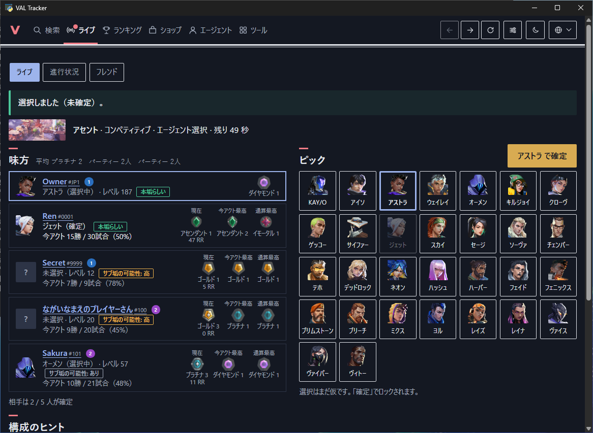
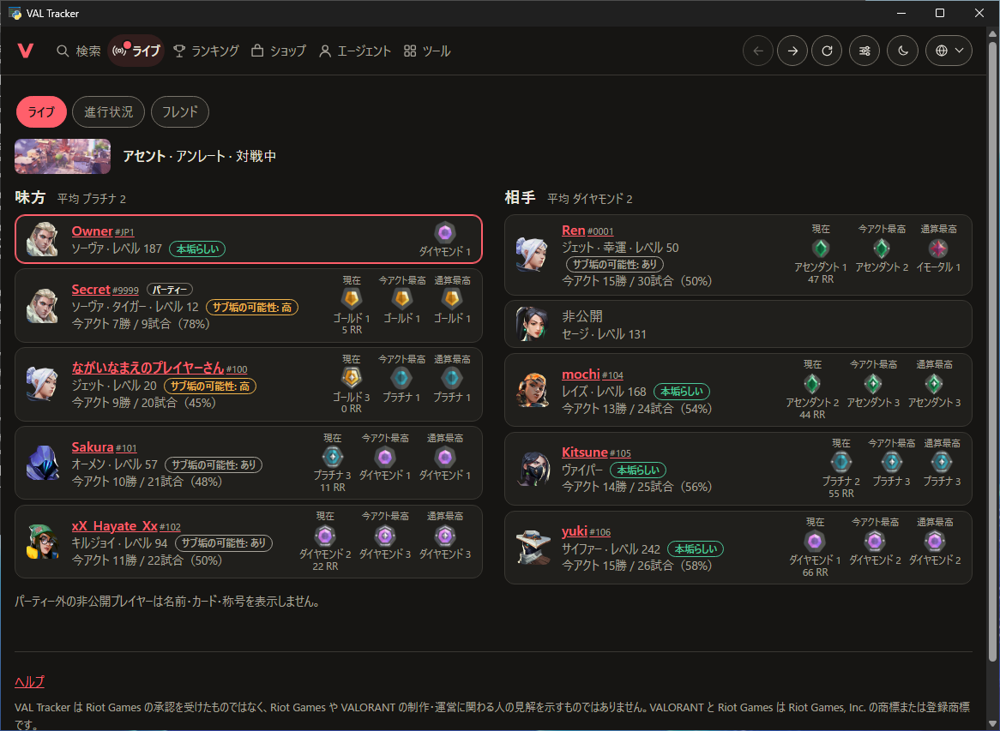
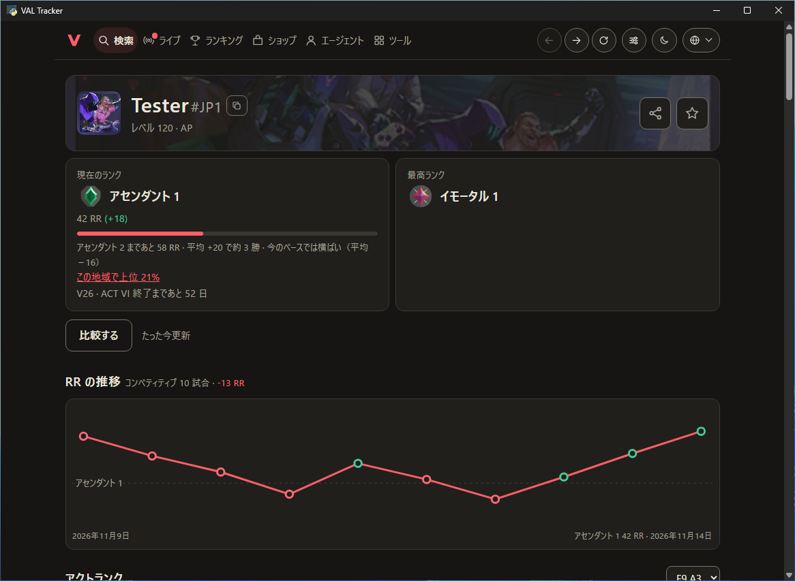

# PC アプリのスクリーンショット

Windows の PC アプリ（`VALTracker.exe`）の実際のウィンドウを撮ったもの。サイト（`/val`）も同じ画面。

- 写っているプレイヤー・試合・数字・持ち主（Owner#JP1、Tester#JP1 など）はすべて作りもの。誰のアカウントも読んでいない
- エージェント・マップ・ランク・武器・スキンの名前と絵はゲームのもの（valorant-api.com から）
- 撮り直し: GitHub の Actions →「Screenshots」→ Run workflow（ブランチで）。`tests/ui/shots.py` が Windows のランナーで
  アプリのウィンドウを開いて撮り、そのブランチにコミットする。作りものの試合は `tests/ui/played.py`、サーバーは
  `tests/ui/serve.py --desktop --real`

枚数は 3 枚だけ（2026-11-14、持ち主: 「３枚くらいでいい」）。撮り直しのたびに Windows のランナーが動くので、増やさない。

## ライブ（自分のゲームをリアルタイムで）

エージェント選択。味方のランク（現在・今アクト最高・通算最高）と今アクトの成績、ピックと確定、味方にまだいない役割。
名前を隠している人の名前は出さない。

対戦中。両チーム 10 人のエージェント・ランク・今アクトの成績と、チームの平均ランク。

## プレイヤー

いまのランクと RR、次のランクまで、地域での位置、RR の推移。

